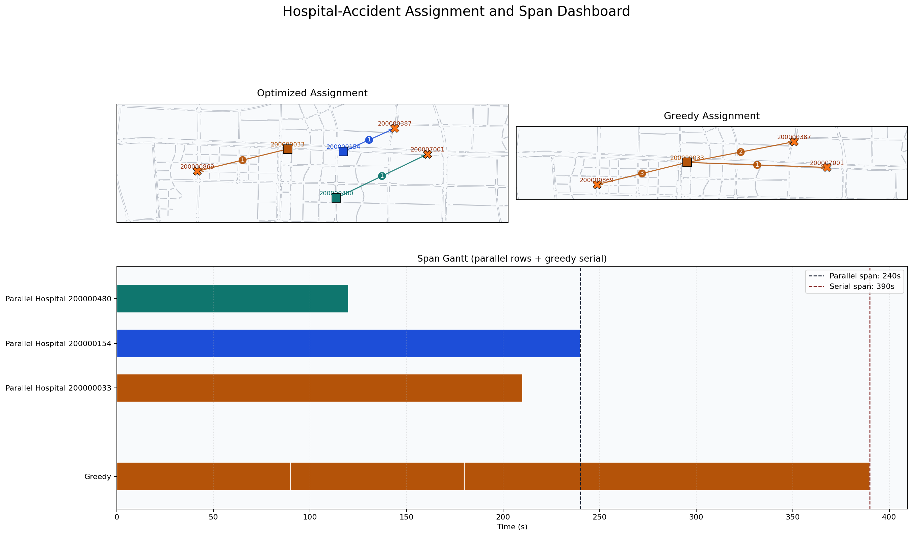

# Simulation_based_ETA_version

本目录实现了一个“多事故应急调度”算法：

1. 在同一次仿真里批量注入多个 OD 探针车，得到 ETA（出发点到目的点的仿真通行时间）。
2. 把 ETA 结果整理成医院-事故点时间矩阵。
3. 基于时间矩阵做优化分配（最小化最大响应时间，Min-Max）。
4. 可视化优化分配与 greedy 分配的空间和时间对比。

---

## 目录结构

- get_od_eta.py: 多 OD 一次性仿真探针，输出 ETA 结果。
- run_get_od_eta.sh: 运行 get_od_eta.py 的便捷脚本。
- time_matrix_generation.py: 从 ETA 结果生成医院-事故点时间矩阵。
- optimization_from_time_matrix.py: 用 LP 优化与 greedy 基线做调度对比。
- case 1 (每个医院的容量限制为1辆车): 运行示例
    - case1/location_input.json: 场景输入（医院和事故点路段 ID）。
    - case1/time_matrix.json: 生成的时间矩阵。
    - case1/optimization_result.json: 优化输出结果。
    - case1/visualize_assignment_and_span.py: 生成 assignment/gantt/dashboard 图。
- case 2 (每个医院的容量限制为3辆车): 运行示例
    - case1/location_input.json: 场景输入（医院和事故点路段 ID）。
    - case1/time_matrix.json: 生成的时间矩阵。
    - case1/optimization_result.json: 优化输出结果。
    - case1/visualize_assignment_and_span.py: 生成 assignment/gantt/dashboard 图。

---

## 运行流程

建议在目录根执行：

```bash
cd /home/nkk/work/src/python/Multi_Accident/Simulation_based_ETA_version
```

### Step 1: 计算多 OD ETA

```bash
bash run_get_od_eta.sh
```

或直接运行：

```bash
/home/nkk/work/src/python/.venv/bin/python get_od_eta.py \
  --warmup_steps 10 \
  --max_probe_steps 60 \
  --departure_stagger_steps 0
```

默认会读取：

- case1/location_input.json

默认会输出：

- eta_res.json

### Step 2: 生成时间矩阵

```bash
python3 time_matrix_generation.py
```

注意：当前脚本读取的是 case1/eta_res.json。
如果 Step 1 只生成了根目录下的 eta_res.json，需要手动同步一次：

```bash
cp eta_res.json case1/eta_res.json
```

生成输出：

- case1/time_matrix.json

### Step 3: 做优化分配与对比

```bash
python3 optimization_from_time_matrix.py
```

生成输出：

- case1/optimization_result.json

### Step 4: 可视化

```bash
python3 case1/visualize_assignment_and_span.py
```

典型输出：

- case1/assignment_map.png
- case1/span_gantt.png
- case1/assignment_span_dashboard.png

---

## 结果展示（case1 示例）

以下结果来自当前 case1 的输出文件：

- case1/time_matrix.json
- case1/optimization_result.json

### 关键指标

- LP 状态：Optimal
- Greedy makespan：390 s
- Optimized makespan：240 s
- 绝对改进：150 s
- 相对改进：38.46%

### 分配结果对比

Optimized assignment：

- Hospital 200000480 -> Accident 200007001
- Hospital 200000154 -> Accident 200000387
- Hospital 200000033 -> Accident 200000869

Greedy assignment（本 case 下更串行）：

- Hospital 200000033 -> Accident 200007001, Accident 200000387, Accident 200000869

### 可视化结果



说明：从该案例可以直观看到，优化方案将任务分散到多个医院并行处理，明显压缩了总完成时间（span）。

---

## 输入输出说明

### 输入: case1/location_input.json

格式示例：

```json
{
  "hospitals": ["200000480", "200000154", "200000033"],
  "accidents": ["200000387", "200007001", "200000869"]
}
```

脚本会自动生成双向 OD（医院->事故点，事故点->医院），用于构建往返总耗时。

### 输出: eta_res.json / case1/eta_res.json

每条记录包含：

- od_index
- start_road
- end_road
- person_id
- departure_time
- started_time
- arrived_time
- eta_seconds
- arrival_reason

### 输出: case1/time_matrix.json

键为 "Hospital xxx" 到 "Accident yyy" 的总往返耗时（秒）。
考虑到事故响应的速度要求，规定时间内（case设定为半小时）不可达时使用 9999 填充空值。

### 输出: case1/optimization_result.json

包含：

- LP_status
- max_response_time
- optimized_assignment
- greedy_assignment
- greedy_makespan
- optimized_makespan
- improvement
- improvement_percentage

---

## 参数速览（get_od_eta.py）

- --mongo_uri: Mongo 连接串。
- --map_db / --map_coll: 路网库与集合。
- --agent_db / --agent_coll: 人车代理库与集合（模板来源）。
- --start: 仿真起始步。
- --interval: 每步推进秒数。
- --warmup_steps: 注入前热身步数。
- --departure_delay_steps: 所有探针统一延迟出发步数。
- --departure_stagger_steps: 相邻 OD 探针错峰步数。
- --max_probe_steps: 追踪探针最大步数。

---

## 依赖

- Python 3.9+
- pymongo
- networkx
- pulp
- matplotlib
- trafficlight_rl（本仓库内）